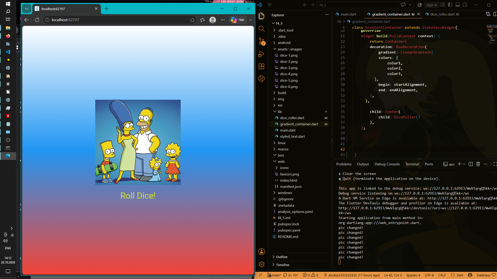

# Flutter 4-5

**Выполнил:** Чумаченко Михаил
**Группа:** ИСП-242  


## 📝 Что было изучено и реализовано
В ходе выполнения лабораторной работы были освоены ключевые концепции построения интерфейсов во Flutter:
1. **Дерево виджетов и компонентный подход:** научились декомпозировать сложный интерфейс на отдельные независимые виджеты (`GradientContainer`, `StyledText`) для улучшения читаемости и повторного использования кода.
2. **Работа со статичным и динамическим UI:** изучили разницу между виджетами без состояния (`StatelessWidget`) и виджетами с динамически изменяемым состоянием (`StatefulWidget`).
3. **Управление состоянием (State Management):** реализовали обновление интерфейса при помощи метода `setState()`.
4. **Работа с ресурсами (Assets):** научились подключать сторонние локальные изображения в конфигурационном файле `pubspec.yaml` и использовать их через `Image.asset`.
5. **Взаимодействие с пользователем:** добавили обработку нажатий кнопкой `TextButton` и генерацию случайных чисел с помощью библиотеки `dart:math`.


## Инструкция по запуску проекта


1. **Клонируйте репозиторий:**
   ```bash
   git clone <url>
   cd f4_5
   ```
2. **Загрузите зависимости проекта:**
   ```bash
   flutter pub get
   ```
3. **Запустите приложение**
   ```bash
   flutter run -d edge
   ```


## Скриншот финального приложения




## Ответы на контрольные вопросы

### 1. Зачем выносить виджеты в отдельные файлы? Что изменится если держать всё в main.dart?
Вынос виджетов в отдельные файлы — это стандарт декомпозиции во Flutter. Это делает код чистым, модульным и структурированным, позволяя легко переиспользовать компоненты в разных частях приложения. Если держать всё в `main.dart`, файл быстро разрастется до тысяч строк кода, станет абсолютно нечитаемым, а совместная работа над проектом в Git превратится в постоянное разрешение конфликтов слияния.

### 2. Что такое BuildContext? Почему метод build() принимает его как параметр?
`BuildContext` — это объект, представляющий собой «карту» или указатель на конкретное место данного виджета в общем дереве элементов приложения. Метод `build()` принимает его, так как Flutter должен знать, где именно отрисовывается виджет, чтобы правильно обрабатывать размеры, наследовать темы (Theme), осуществлять навигацию (Navigator) и искать другие виджеты выше по дереве.

### 3. Чем StatelessWidget отличается от StatefulWidget? Приведите пример когда нужен каждый из них.
*   **StatelessWidget** — это неизменяемый виджет. Он отрисовывается один раз на основе переданных в него параметров и не может сам перерисовать себя. *Пример:* Иконка, статичный текст заголовка или фоновый градиент.
*   **StatefulWidget** — это виджет, который имеет внутреннее изменяемое состояние (`State`). Он умеет отслеживать действия пользователя и динамически перестраивать свой интерфейс на лету. *Пример:* Наше приложение с игральной костью (где картинка меняется по нажатию кнопки) или поле ввода текста.

### 4. Почему Random() создаётся на уровне файла, а не внутри rollDice()?
Создание объекта `Random` внутри функции `rollDice()` приводило бы к тому, что при каждом нажатии на кнопку в памяти инициализировался бы совершенно новый генератор случайных чисел. Это нерационально расходует ресурсы процессора и памяти. Создание объекта на уровне файла (как глобальной константы) инициализирует генератор всего один раз, позволяя эффективно использовать его повторно при каждом броске кубика.
Используйте код с осторожностью.
Если нужно, я могу помочь дописать ответы на вопросы или изменить описание шагов запуска, если вы использовали эмулятор вместо Chrome. Дайте знать!
